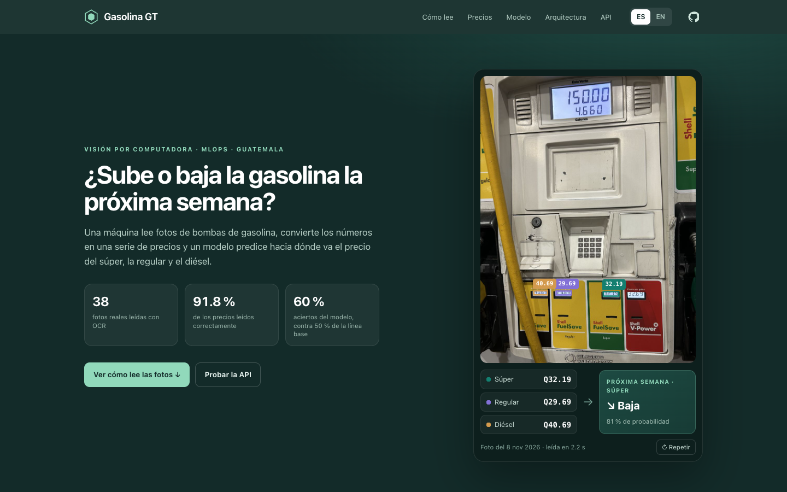

# Gasolina GT

¿Sube o baja la gasolina en Guatemala la próxima semana? Panel web y API REST con los precios
semanales de súper, regular y diésel **leídos de fotos de rótulos de gasolineras con OCR**,
comparados con la referencia oficial del Ministerio de Energía y Minas (MEM), y la predicción
de un modelo de clasificación sobre la dirección del precio la semana siguiente.

**Demo en vivo:** https://gasolina-gt.onrender.com · [Swagger](https://gasolina-gt.onrender.com/docs)
· [Repositorio del proyecto completo](https://github.com/ArielaMishaanCohen/equipo-06-gasolina-gt)
(plan gratuito: la primera visita puede tardar ~50 s en despertar el servicio).



## Qué hay detrás

Este repositorio es la versión de portafolio del proyecto final de *ML Engineering* (UVG, 2026),
hecha para servir la demo en Render. **El código completo del proyecto** (pipeline de Databricks,
definición del Job, paquete de OCR y modelo, tests, CI/CD y documentación) está en
[equipo-06-gasolina-gt](https://github.com/ArielaMishaanCohen/equipo-06-gasolina-gt).

El sistema original corre como un pipeline medallón en Databricks:

| Capa | Qué hace |
| --- | --- |
| **Bronce** | Ingesta incremental de 38 fotos HEIC de rótulos (Auto Loader) con sus metadatos |
| **Plata** | OCR con RapidOCR y reglas de calidad; 91.8 % de 85 precios leídos correctamente frente a etiquetas manuales; lo dudoso va a cuarentena |
| **Oro** | Precio y variación semanal, variables con el histórico del MEM y el precio del petróleo (FRED); regresión logística contra una línea base, registrada en MLflow |
| **Orquestación** | Job de Databricks Bronce → Plata → Oro, programado cada martes, con alertas por correo |
| **API** | FastAPI sobre la capa Oro, desplegada en un servidor Linux con `uv` |

La página, en español o en inglés (interruptor ES/EN o `?lang=en`), tiene dos pestañas:

**Precios hoy**: responde *¿lleno el tanque hoy o espero?* para súper, regular o diésel, con la
probabilidad del modelo, una calculadora de cuánto cuesta llenar (moto, carro, pickup o galones a
mano) y cuánto ahorrarías esperando, los precios de la semana y la tendencia del combustible.

**Cómo funciona**:

- **Así lee las fotos**: las 38 fotos con lo que detectó el OCR, el precio leído frente al
  etiquetado a mano y las correcciones que aplicaron las reglas.
- **Precio por semana**: la referencia del MEM frente a lo leído de las fotos.
- **¿Acierta el modelo?**: la predicción de la semana siguiente y las 10 semanas de prueba,
  casilla por casilla, contra la línea base.

Esta versión sirve una **instantánea de las cinco tablas Oro** (exportada el 15 de noviembre
de 2026) en `data/oro/*.parquet`, junto con los resultados del OCR (`data/fotos.json`, fotos reducidas y sin
metadatos en `data/img/`) y de la prueba temporal (`data/backtest.json`), así que corre sola, sin credenciales ni servicios externos.

**Resultado del modelo** (validación temporal, 10 semanas de prueba): accuracy 0.60 y F1 macro
0.313, frente a 0.50 y 0.256 de la línea base que repite la dirección de la semana anterior.

## Endpoints

| Método | Ruta | Descripción |
| --- | --- | --- |
| GET | `/` | Panel web |
| GET | `/health` | Estado del servicio y de cada tabla Oro |
| GET | `/precios/actual` | Último precio semanal por combustible |
| GET | `/precios?combustible=diesel&desde=2026-10-01&hasta=2026-11-30&limit=5` | Histórico con filtros y paginación |
| GET | `/prediccion?combustible=super` | Dirección de la semana siguiente y su probabilidad |
| GET | `/modelo/metricas` | Exactitud y F1 del modelo frente a la línea base |
| GET | `/modelo/backtest` | Predicción contra la realidad en las 10 semanas de prueba |
| GET | `/fotos?detalle=true` | Lo que leyó el OCR en cada foto (recuadros y precios) frente al precio real |
| GET | `/docs` | Documentación interactiva (Swagger) |

## Correr en local

```bash
uv sync
uv run uvicorn gasolina_gt.app:app --reload   # http://localhost:8000
uv run --extra dev pytest
```

## Despliegue en Render

`render.yaml` define un *web service* gratuito: Render → **New → Blueprint** → elegir este
repositorio. El plan gratuito se suspende tras 15 minutos sin tráfico y tarda unos segundos en
despertar con la primera visita.

## Créditos

Equipo 06 de CC3105 *ML Engineering*, Universidad del Valle de Guatemala: Alina Carias,
Marcos Diaz, Daniel Machic, Ignacio Mendez, Ariela Mishaan y Diego Soto.
